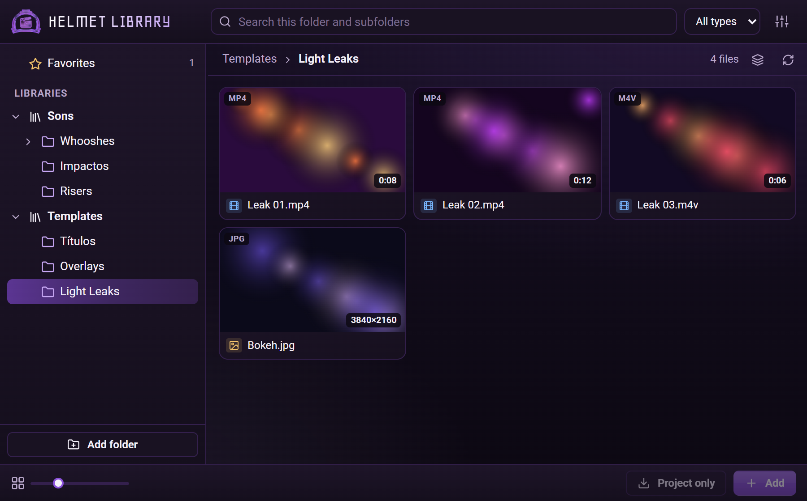

# Helmet Library

**English** · [Português](README.pt-BR.md)

A CEP extension for Adobe Premiere Pro that turns folders on your computer into asset libraries (videos, sounds, images, MOGRTs, templates) available right in a panel, with preview and placing on the timeline by dragging or with one click. The idea is the same as Animation Composer's "User Library".

It uses the same visual identity as [Helmet DL](https://github.com/derpbizinoto/helmet-dl) and [Helmet Cutter](https://github.com/derpbizinoto/helmet-cutter): Classic theme (Violet Terminal with subtle gradients), Geo in caps for the name and Roboto everywhere else.

Current version: **1.2.0** (what changed is in [CHANGELOG.md](CHANGELOG.md), Portuguese). Tested as reference on Premiere Pro 26.x on Windows.

Free and open source ([MIT license](LICENSE)).



**[⬇ Download the latest version](https://github.com/derpbizinoto/helmet-library/releases/latest)**: Premiere Pro on Windows.

## Installation

### Easy way (Windows)

1. Download `HelmetLibrary-<version>.zip` from the [releases page](https://github.com/derpbizinoto/helmet-library/releases/latest) and extract it.
2. Close Premiere.
3. Double-click **`instalar.bat`** (next to the `premiere-helmet-library` folder). It:
   1. copies the extension to `%APPDATA%\Adobe\CEP\extensions\premiere-helmet-library` (without the `.debug` debugging file);
   2. allows unsigned extensions (`PlayerDebugMode`) and checks that it worked;
   3. warns if there's an old copy in `C:\Program Files (x86)\Common Files\Adobe\CEP\extensions` (it would make the panel show up twice).

   No administrator needed. Your libraries and settings are not deleted.
4. In Premiere: **Window › Extensions › Helmet Library**.

### Manual way

1. Close Premiere.
2. Copy the `premiere-helmet-library` folder to `C:\Users\<you>\AppData\Roaming\Adobe\CEP\extensions\` (without the `.debug` file, if it exists).
3. Double-click **`Add Keys.reg`** if you haven't already done it for another Helmet extension (it does the same as step 2 of the installer).
4. In Premiere: **Window › Extensions › Helmet Library**.

### First use

Click **Add folder** (at the bottom of the left bar) and pick a folder on your computer with your sounds, videos, images, MOGRTs… You can add as many folders as you like; subfolders show up in the tree on the left.

## How to use

- **Add folder** (at the bottom of the sidebar): pick a folder on your computer. It becomes a library, and its subfolders show up in the tree. You can add as many as you like.
- Click a folder in the tree to see its files. The subfolder cards and the path at the top also navigate.
- **Preview:** clicking a file opens the preview at the bottom (audio and video play on their own, which can be turned off). Clicking the same file again closes the preview. Videos and images get a larger preview, and the progress bar shows the exact timecode (hover to see the time at any point, drag to seek). The preview only shows while a file is selected: clicking an empty spot in the grid or pressing Esc closes it. On hover, only GIFs animate in the card; videos and MOGRTs show a still thumbnail.
- **To use it in the project:**
  - drag the card (or several selected ones) to the **timeline** or the **Project** panel. **Video** goes straight in, the same way Animation Composer drags video: only the file path, and Premiere itself imports and places it on drop (the video lands where Premiere puts it, not in the Helmet Library bin). A dragged **MOGRT** shows up for a moment as a gray image with its name, which turns into the real MOGRT in the same spot within about 2 seconds (Premiere doesn't accept a `.mogrt` dragged from a panel); several in a row stay in a row. As in Animation Composer, the image drop is undone (Premiere's Ctrl+Z) before the MOGRT goes in, so whatever the image covered comes back whole, and the MOGRT stays selected. Dropped on the Source Monitor or on a timeline without a sequence, the image is removed and the bottom bar explains why. MOGRTs go in a drag of their own: if the selection has other files too, only the MOGRTs go and the bottom bar tells you. MOGRTs don't go into the Project panel (Premiere doesn't accept them), so drag them to the timeline. The temporary images live in `%LOCALAPPDATA%\Helmet Library\arrastar`. Audio and images go straight in, as always;
  - or **Add** / Enter / double-click: places it on the timeline, at the playhead, on the first free track (if there isn't one, it creates a track);
  - or **Project only** / Shift+Enter: imports without touching the timeline.
- **Favorites:** the star on the card (shows on hover) or the right-click menu.
- **Search:** searches the open folder and all its subfolders. To search the whole library, click the library's name in the tree first. The selector next to it filters by type.
- **Subfolders together:** the layers button, next to the counter, shows the files of the folder and all its subfolders in a single grid.
- **Pitch and Reverse:** only change the audio preview, never the file or the clip on the timeline.
- The thumbnail size is in the control at the bottom-left corner, and the sidebar can be resized by dragging its edge.

Shortcuts: arrow keys to navigate, Ctrl+click and Shift+click to select several, Ctrl+A, Space plays and pauses, Ctrl+F goes to search, Backspace goes up a folder, Esc clears the search (or the selection).

### Formats

| Type | With preview | Without preview (shown with an icon and can be added) |
|---|---|---|
| Video | MP4, M4V, MOV (H.264), WebM | MOV ProRes/other codecs, AVI, MXF, MKV, WMV, MPG, MTS |
| Audio | WAV, MP3, M4A, AAC, OGG, FLAC (waveform) | AIF/AIFF, WMA |
| Image | JPG, PNG, GIF (animated), BMP, WebP, SVG | PSD, AI, EPS, TIFF, TGA, EXR, DPX |
| MOGRT | thumbnail and preview video from inside the `.mogrt` | — |
| Other | — | AEP, PRPROJ, AEGRAPHIC, FFX, CUBE, SRT, XML |

With "Show other files" on in the settings, the grid also lists what Premiere doesn't import. The format list is in `client/js/config.js`.

## Settings (controls icon at the top)

- **Where to save previews:**
  - *Inside the library* (default): in a hidden `.helmet-previews` folder at the root of each library. The key uses the relative path, so if you copy the library to another drive or PC, the previews come along.
  - *System cache*: in `%LOCALAPPDATA%\Helmet Library\cache`, without writing anything into the library folders. Use this option if the library is in a read-only folder (the panel warns when it can't write).
  - *Clear previews*: asks for confirmation, shows how many files and how much space, and deletes only the preview files created by the extension (your videos, sounds and images are never touched). Previews are rebuilt when the folders are opened again.
- **Import into a "Helmet Library" bin** and **Recreate folders as bins** (e.g. `Helmet Library › SFX › Whooshes`). The same file is never imported twice: if it's already in the bin, it's reused.
- **Double-click on a file:** choose between adding to the timeline and only importing into the project.
- **Play on select** and **Show other files**.
- **Language / Idioma:** the panel opens in English; pick *Português (Brasil)* to switch. Takes effect immediately and is saved.

Folders are watched: new files show up on their own (the refresh button forces a reread).

## Your data

- Libraries, favorites and settings are in `%APPDATA%\Helmet Library\config.json`, which isn't deleted when you reinstall.
- Every save goes to a temporary file first and only then replaces the original (a power outage doesn't leave the file half-written), and the previous version is kept in `config.json.bak`.
- If `config.json` gets corrupted, the panel warns you, keeps the broken file as `config.corrompido-<date>.json` (nothing is deleted) and restores the backup. Without a backup, it starts empty.
- If it can't save (disk full, no permission), a warning shows in the bottom bar.

## External drives, network folders and large libraries

- A library whose folder is gone (drive unplugged, network down, folder moved or renamed) is marked in the tree and, when clicked, the panel explains what to do. When the drive or the network comes back, it comes back on its own (the panel checks on open, on click, on refresh and when you return to the panel).
- Favorites that weren't found are counted in a warning.
- None of this freezes the panel: disk reads don't block the screen, and previews are only generated for the cards on screen, two at a time.
- Search and "Subfolders together" show at most 20,000 files (with a warning). The result is kept for 30 seconds, so typing in the search doesn't reread the disk on every letter.

## Known limitations

- **MOGRT into the project only:** some Premiere versions don't import a `.mogrt` straight into the Project panel by script. In that case the extension warns you, and the MOGRT can go to the timeline as usual (Add button, double-click or dragging).
- **MOGRT duration:** free space on the track is checked for 1 s from the playhead, because the template's duration is only known after it's inserted.
- **Audio over 300 MB:** gets no waveform and plays through the simple player, without Pitch and Reverse (decoding the whole file would weigh too much on memory).
- **Video with mismatched tracks:** a video needs a free V and A with the same number. Example: in a sequence with only V1/A1, with the playhead still, adding two audio files (the second creates A2) and then a video gives "There's no free track at the playhead", because the extension creates V2/A3 and looks for the V2/A2 pair. To work around it, move the playhead or create a video track by hand. Old behavior, kept on purpose in this version (item P1 in `AUDITORIA.md`).
- **Signing:** the extension isn't signed yet (`.zxp`), so the installer turns on `PlayerDebugMode`.

## Structure

```
premiere-helmet-library/
  CSXS/manifest.xml        CEP manifest (Node on: --enable-nodejs and --mixed-context)
  client/index.html        panel (with a Content-Security-Policy: no inline or internet scripts)
  client/css/style.css     Violet Terminal identity
  client/js/
    config.js              version, file types, defaults, limits and timings; HL.log / HL.warn
    i18n.js                panel language and the English translation dictionary (right after config.js)
    bridge.js              the single panel → Premiere bridge (JSON both ways)
    library.js             Node side: config.json, folder reading, shortcuts, cache, .mogrt reader, watcher, Windows programs
    demo.js                sample library when opened outside Premiere (regular browser)
    previews.js            thumbnails, video frames and waveforms (queue, 2 at a time)
    player.js              bottom player (Web Audio for pitch/reverse, <video>, )
    app.js                 UI base: state, elements, status bar, favorites
    tree.js                sidebar tree
    grid.js                grid: listing, cards, selection, keyboard, dragging
    host.js                adding to Premiere
    libraries.js           libraries: add, remove, watch, disconnected, clear previews
    menus.js               right-click menus and confirmation dialog
    settings.js            settings window
    main.js                top bar and panel startup
  host/index.jsx           ExtendScript: imports into the bin, places on the timeline (free track), importMGT for MOGRTs
  icons/                   panel icons
instalar.bat               installer (Windows)
Add Keys.reg               allows unsigned extensions (manual alternative)
empacotar.ps1              builds the .zip for distribution
tests/                     automated tests (Node)
AUDITORIA.md               security and cleanup audit, Premiere tests and dragging (Portuguese)
```

## For developers

### Automated tests

You need [Node.js](https://nodejs.org). In the project folder:

```bash
node tests/run-tests.js
```

They test what can be tested outside Premiere: settings (backup, corrupted file), folders and shortcuts, cache, the `.mogrt` reader (including damaged files), the Premiere bridge with tricky names and `host/index.jsx` running on a "fake Premiere" (`tests/premiere-mock.js`). What can only be seen in Premiere (dragging, Esc, disconnected panel) needs to be tested in Premiere.

### Building the package

```bash
powershell -ExecutionPolicy Bypass -File .\empacotar.ps1
```

Builds `dist\HelmetLibrary-<version>.zip` with the extension, `instalar.bat`, `Add Keys.reg`, the READMEs, the LICENSE and the CHANGELOG. It stops with an error if the four versions don't match (the two in `manifest.xml`, `CLIENT_VERSION` in `client/js/config.js` and `HL_HOST_VERSION` in `host/index.jsx`) or if it finds a certificate, key or `.debug`.

### Rules the extension follows

- Text from files (names, MOGRT titles) goes on screen only as text (`textContent`), never as HTML.
- Everything sent to Premiere goes through `bridge.js` as JSON; `index.jsx` always answers `{ ok, data, error }`.
- Windows programs (Explorer, `attrib`) are called by their full path, with an argument list, without a command prompt.
- Shortcuts (links) are only followed if they point inside the same library; the previews folder can never be a shortcut.
- No `eval`, no `innerHTML` with data and no files from the internet.
- **Text:** written in Portuguese inside `tr("…")` (or `N("…")` for stored sentences, shown
  later with `tr()`/`trMsg()`); the English translation lives in the `EN` dictionary in `client/js/i18n.js`.
  Messages from `host/index.jsx` stay in Portuguese and the panel translates them on arrival. A new sentence without a translation
  makes the tests fail.

### Debugging

- **Console:** in `client/js/config.js`, `DEBUG: true` shows details in the panel console that are normally hidden (preview failures, dragging, folder watcher). Set it back to `false` before distributing.
- **Debugging port:** the `premiere-helmet-library/.debug` file turns on port 8099 (with the panel open, go to `http://localhost:8099` in Chrome). It's **not in git and doesn't go into the install**: with Node on, anyone who connects to that port can run programs on the computer. To debug on your machine, create the file with the content below and copy the extension folder by hand (`instalar.bat` deletes `.debug`).

```xml
<?xml version="1.0" encoding="UTF-8"?>
<ExtensionList>
    <Extension Id="com.seuestudio.helmetlibrary.panel">
        <HostList>
            <Host Name="PPRO" Port="8099" />
        </HostList>
    </Extension>
</ExtensionList>
```

Opened directly in a browser, `client/index.html` goes into demo mode with a sample library, handy for working on the layout.

## License

[MIT](LICENSE). The Geo and Roboto fonts have their own license (SIL Open Font License 1.1, see the license texts in `client/fonts/`).
